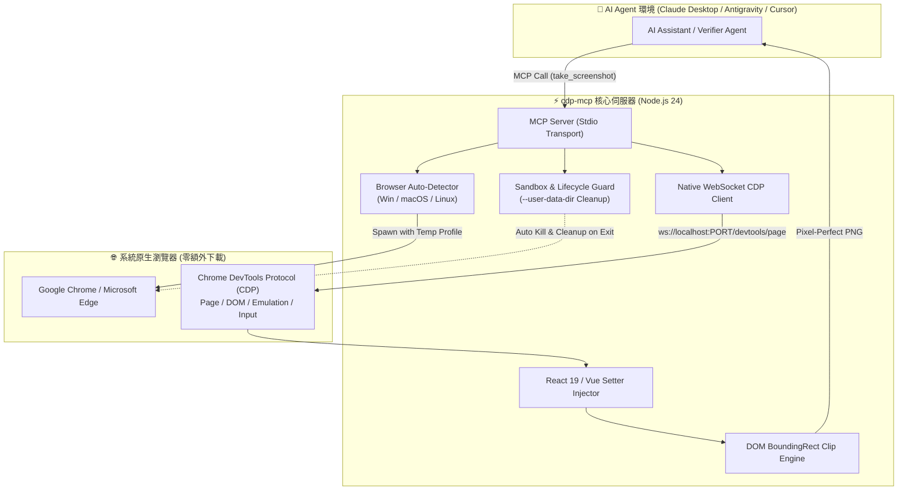

<div align="center">

# 📸 cdp-mcp

### Zero-Dependency, High-Precision Chrome DevTools Protocol (CDP) MCP Server  
**專為真實瀏覽器視覺驗收、UI 跑版檢測與極速自動化打造的原子化 MCP 伺服器**

[](https://opensource.org/licenses/Apache-2.0)
[](https://modelcontextprotocol.io/)
[](https://nodejs.org/)
[](https://www.typescriptlang.org/)
[](#-why-cdp-mcp)
[](https://github.com/xx8897/cdp-mcp)

<p align="center">
  <a href="#-why-cdp-mcp">核心優勢</a> •
  <a href="#-architecture">系統架構</a> •
  <a href="#-quick-start">快速開始</a> •
  <a href="#-tools-specification">MCP 工具規範</a> •
  <a href="#-market-comparison">市場評測白皮書</a> •
  <a href="#-visual-verifier-agent">專屬特工</a> •
  <a href="#-license">授權條款</a>
</p>

---

### ⭐️ 喜歡這個專案嗎？歡迎在 GitHub 點個 Star！
**如果 `cdp-mcp` 幫助您的 AI Agent 解決了截圖跑版或龐大依賴的困擾，請不要吝嗇為我們點亮一顆右上角的 ⭐️ Star！**  
您的支持是持續維護與推動零依賴開源生態的最大動力。

---

</div>

## 💡 Why cdp-mcp? (為什麼選擇 cdp-mcp？)

在當前的 AI Agent 與自動化領域中，網頁視覺驗收面臨著嚴重的「兩極化困境」：

1. **官方派 (Playwright / Puppeteer MCP)**：動輒下載 300MB+ 的獨立 Chromium 核心，記憶體開銷大、啟動遲緩，嚴重浪費磁碟與資源。
2. **開源 CDP 派 (如 undetectable-io、cdp-browser-mcp)**：
   - ❌ **無法全自動接管**：要求使用者必須**手動提前開好 Chrome**，並手動傳入 `--remote-debugging-port=9222`。
   - ❌ **Token 瘋狂浪費**：提供多達 25 個細碎的底層工具（如 NewTarget, Connect, PageEnable, DOMGetDocument），一個簡單的截圖需與 LLM 來回往返 8 輪，狂吃 **20,000+ Tokens**！
   - ❌ **現代前端狀態阻攔**：使用傳統 `.value = ...` 賦值會直接被 React 19、Vue 的受控組件（Controlled Components）虛擬 DOM 丟棄。

### 🌟 `cdp-mcp` 的顛覆性解法：

* 🚀 **極致零依賴 (Zero Dependency)**：徹底拋棄動輒數百 MB 的 Puppeteer/Playwright，僅依賴 Node.js 原生 `WebSocket` 與系統既有 Chrome/Edge。
* 🔍 **全自動跨平台探測**：免手動開瀏覽器！自動尋找本機 Chrome / Edge，啟動獨立 Temp Profile 沙盒，任務結束**自動秒殺釋放記憶體**。
* ⚡️ **高階原子複合操作 (One-Shot Action)**：將「導航 + 表單注入 + 點擊展開 + 局部裁切」收斂為單一工具呼叫，**1 輪往返、僅耗費 ~1.5k Tokens**。
* 🧬 **React 19 / Vue 原生描述符穿透**：內建 `HTMLInputElement.prototype` Setter 劫持技術，100% 穿透 React/Vue 受控表單。
* 📐 **CSS Selector 像素級無損裁切**：透過 Chrome 渲染管線直接在物理邊界裁切 PNG，絕不產生縮放模糊。

---

## 🏛️ Architecture (系統架構)



---

## 📊 市面主流 CDP 解決方案橫向對比

我們對市面上主流方案進行了全維度的深度實測（包含 2026 最新開源專案與具備 25 款工具的重型方案）：

| 評估維度 | 官方派 (Playwright MCP) | 開源 CDP 派 (cdp-browser-mcp 等) | 重型控制派 (chromium-cdp-mcp) | 🌟 **cdp-mcp (本專案)** |
| :--- | :---: | :---: | :---: | :---: |
| **外部套件體積** | ❌ 300MB+ Chromium | 🟡 中等 (依賴第三方驅動) | 🟢 輕量 (原生 WebSocket) | 🟢 **極致輕量 (0 下載，系統原生)** |
| **瀏覽器生命週期** | 啟動慢，常駐耗能 | ❌ 需**手動提前開瀏覽器** | ❌ 需**手動開瀏覽器**且必傳 Port | 🟢 **全自動探測啟動、用完自動秒殺** |
| **呼叫原子化程度** | 多步驟來回 | 多步驟來回 | ❌ 25 個細碎 Tool (來回 8 輪) | 🟢 **高階複合一步到位 (1 輪完成)** |
| **React 19 / Vue 穿透**| 框架級模擬 | ❌ 無 (普通 .value= 易失效) | ❌ 無 (Input.insertText 易丟事件) | 🟢 **原生 Setter 描述符注入，100% 穿透** |
| **DOM 局部無損裁切** | 需手動計算座標 | ❌ 僅 Viewport/FullPage | ❌ 僅 Viewport/FullPage | 🟢 **CSS Selector 像素級無損裁切** |
| **Token 消耗效率** | 🔴 消耗較高 | 🟡 中等 (~5k tokens) | 🔴 8 輪往返 (~20k tokens) | 🟢 **單次原子呼叫 (~1.5k tokens)** |
| **開源憑證** | Apache-2.0 | MIT License | MIT License | 🛡️ **Apache-2.0 (專利防衛)** |

> 📚 **深入評估白皮書**：
> - 🌐 **[多方案全景橫向評估白皮書](./docs/market_cdp_solutions_comparison.md)**：五大派系在 Token、內存、並發與現代 Web 兼容性深度對決。
> - 🥊 **[1v1 單挑深度對照報告](./docs/comparison_with_undetectable_cdp.md)**：針對 undetectable-io 25 款細碎工具的原子化對照。

---

## 🚀 Quick Start (快速開始)

### 1. 安裝與建置

```bash
# Clone 本專案
git clone https://github.com/xx8897/cdp-mcp.git
cd cdp-mcp

# 安裝輕量依賴並編譯 TypeScript
npm install
npm run build
```

### 2. 在 AI 編輯器 / 工具中配置

#### 🔹 Antigravity / Cursor / VS Code (`mcp_config.json`)
```json
{
  "mcpServers": {
    "cdp-mcp": {
      "command": "node",
      "args": ["<PATH_TO_PROJECT>/dist/index.js"]
    }
  }
}
```

#### 🔹 Claude Desktop (`claude_desktop_config.json`)
```json
{
  "mcpServers": {
    "cdp-mcp": {
      "command": "node",
      "args": ["D:/codespace/projects/cdp-mcp/dist/index.js"]
    }
  }
}
```

### 3. 執行自我驗證測試
```bash
node tests/test-mcp.js
```
測試通過後會在 `tests/output/` 目錄產生 `test_sample.png`，即代表 CDP 管道與截圖裁切運作完全正常！

---

## 🦾 Tools Specification (MCP 工具詳細規格)

### 1. `take_screenshot`
對目標網址進行全景視口截圖或精準的 DOM 局部元素裁切。

```json
{
  "name": "take_screenshot",
  "arguments": {
    "url": "http://localhost:3000/dashboard",
    "outputPath": "d:/output/dashboard_card.png",
    "selector": ".analytics-card-primary",
    "waitFor": ".chart-rendered",
    "delay": 1500,
    "width": 1920,
    "height": 1080,
    "dpr": 2
  }
}
```

### 2. `interact_and_screenshot`
先自動完成表單輸入（穿透 React 19 虛擬 DOM）與點擊動作，再執行精準裁切截圖。

```json
{
  "name": "interact_and_screenshot",
  "arguments": {
    "url": "http://localhost:3000/login",
    "outputPath": "d:/output/logged_in_state.png",
    "inputSelector": "#user-email",
    "inputValue": "admin@example.com",
    "clickSelector": "button[type='submit']",
    "waitFor": ".welcome-banner",
    "delay": 1000
  }
}
```

### 3. `inspect_element`
檢測指定 DOM 元素在瀏覽器視口中的真實物理邊界盒（Bounding Box）與可見性，專門用於偵測跑版與元素重疊。

```json
{
  "name": "inspect_element",
  "arguments": {
    "url": "http://localhost:3000",
    "selector": "#submit-btn"
  }
}
```
*回傳範例*：
```json
{
  "success": true,
  "found": true,
  "isVisible": true,
  "rect": { "x": 120, "y": 450, "width": 200, "height": 48 }
}
```

---

## 🤖 Visual Verifier Agent (專屬驗收特工)

本專案附帶專用特工架構：
* 檔案路徑：[`agents/visual-verifier.agent.md`](./agents/visual-verifier.agent.md)
* **核心使命**：前端 UI 實機驗收、跑版比對與視覺審查。
* **安全沙盒 (Read-Only Safety)**：特工僅被授權使用 `mcp__cdp-mcp__*` 與 `read_file`，在物理層面剝奪代碼寫入權限，保證「專職驗收、絕對無法擅自改動業務代碼」。

---

## 📄 License & Attribution (授權與署名條款)

本專案採用 **[Apache License 2.0](./LICENSE)** 授權開源，並隨附官方 **[NOTICE](./NOTICE)** 聲明文件。

```
Copyright 2026 xx8897 and cdp-mcp contributors

Licensed under the Apache License, Version 2.0 (the "License");
you may not use this file except in compliance with the License.
You may obtain a copy of the License at

    http://www.apache.org/licenses/LICENSE-2.0
```

### 🛡️ 專利防禦與商用保障
- **寬鬆商用**：允許個人、團隊或企業自由修改、整合與商業發布。
- **專利反訴防禦條款**：任何使用或參與本專案者均獲得免費專利授權；若有任何實體向本專案提出專利侵權訴訟，其專利授權將立即自動終止，保障獨立開源開發者免於專利蟑螂威脅。
- **NOTICE 強制展示義務（第 4(d) 條）**：任何包含或分發本專案（或衍生作品）的商業產品，必須在軟體版權聲明、說明文件或界面中，完整保留並展示 [NOTICE](./NOTICE) 文件中載明之原創作者姓名與 GitHub 來源連結。
- **修改標記義務（第 4(b) 條）**：依據第 4(b) 條，任何修改過本專案原始碼者，需在修改檔案中標註改動說明。

---

<div align="center">

### 🌟 喜歡這個專案嗎？
如果您認同 **Zero-Dependency** 與 **原子化高效率 AI Agent** 的開發理念，請在 GitHub 為我們點上一顆 **Star ⭐️**！

**[給予 Star 支持](https://github.com/xx8897/cdp-mcp)** • **[提交 Issue 建議](https://github.com/xx8897/cdp-mcp/issues)** • **[查看評測白皮書](./docs/market_cdp_solutions_comparison.md)**

Made with ❤️ by [xx8897](https://github.com/xx8897) and open-source contributors.

</div>
