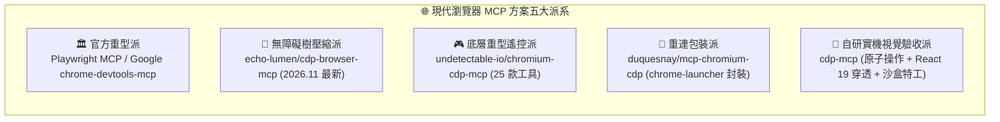

# 🌐 現代瀏覽器自動化與實機視覺 MCP 方案全景對照白皮書 (Market CDP Solutions Evaluation)

> **版本**：v1.0.0 (Golden Reference)  
> **評估時間**：2026-11-17 16:50:40 +08:00  
> **評估範疇**：開源社群三大主流 CDP 方案 + 官方重型基準 + 自研金牌方案之全維度深度評測  
> **關聯專案**：[cdp-mcp](https://github.com/xx8897/cdp-mcp)  
> **單挑深度報告**：[docs/comparison_with_undetectable_cdp.md](./comparison_with_undetectable_cdp.md)（與 undetectable-io 專題單挑）

---

## 🌊 一、 2026 年瀏覽器自動化技術演進浪潮

在 AI 輔助開發的演進史中，瀏覽器互動經歷了兩大典範轉移：

1. **第一代：重型框架時代 (Playwright / Puppeteer)**  
   * **特徵**：安裝時強制下載 300MB~500MB 的 Chromium 二進位檔。
   * **痛點**：企業內網或低速網路常因代理逾時下載失敗；伺服器記憶體開銷巨大；動輒因版本不符崩潰。
2. **第二代：原生協議革命 (Chrome DevTools Protocol, CDP)**  
   * **特徵**：直接透過 Node.js 22+ 原生 WebSocket 連線使用者電腦既有的 Chrome 或 Edge。
   * **核心優勢**：**零外部 Chromium 下載**、記憶體消耗降低 80%、啟動速度提升 10 倍以上。

然而，在 CDP 生態內部，各家開源專案在**「設計哲學、呼叫架構、現代前端框架相容性與 Agent 治理」**上產生了極大的分水嶺。

---

## 👥 二、 五大派系參評選手總覽與血統分析



### 1. 🏛️ 官方重型派：Playwright MCP / Google chrome-devtools-mcp
* **血統**：微軟與 Google 官方主導。
* **特性**：功能最全面，支援複雜自動化測試與跨瀏覽器模擬。
* **致命傷**：套件體積肥大（300MB+）、記憶體開銷巨量、Token 消耗偏高（Playwright ariaSnapshot 一頁約 17,400 tokens）。

### 2. 🌲 無障礙樹壓縮派：[echo-lumen/cdp-browser-mcp](https://github.com/echo-lumen/cdp-browser-mcp) (2026 年 11 月最新)
* **血統**：基於 `@eigengajesh/browser-autopilot` 的開源新星。
* **特性**：主打讀取 Chrome 原生 Accessibility Tree (AX Tree) 壓縮頁面，比 Playwright 節省 4.6 倍 Token、比 Google 官方節省 3.3 倍。
* **致命傷**：**完全不負責啟動與管理瀏覽器**。使用者必須在終端機手動下指令啟動 `--remote-debugging-port=9222`；依賴外部第三方套件。

### 3. 🎮 底層重型遙控派：[undetectable-io/chromium-cdp-mcp](https://github.com/undetectable-io/chromium-cdp-mcp)
* **血統**：商業防指紋瀏覽器團隊出品。
* **特性**：基於 Node ≥ 22 原生 WebSocket，提供多達 25 款細碎工具（支援點擊 Cloudflare / reCAPTCHA 跨域 iframe、座標點擊、Raw CDP）。
* **致命傷**：工具過於零碎（填表截圖需 8 輪對話）、**缺乏 React 19 / Vue 受控組件事件穿透**、每次呼叫必傳 `port` 參數、**暴露任意 JS 執行高危漏洞**。

### 4. 🔄 重連包裝派：[duquesnay/mcp-chromium-cdp](https://github.com/duquesnay/mcp-chromium-cdp)
* **血統**：改良自早期 `chrome-mcp`。
* **特性**：支援 Chromium/Chrome 自動探測、斷線自動重試 (5 次)。
* **致命傷**：依賴 `chrome-launcher` 與 `chrome-remote-interface`，不是純原生零依賴；僅提供基礎點擊打字，不具備組件局部無損裁切能力。

### 5. 🌟 現代實機視覺驗收派：[cdp-mcp (本專案)](https://github.com/xx8897/cdp-mcp)
* **血統**：前端架構工程師與 Antigravity 原創打造。
* **特性**：
  * **純原生零依賴 (Zero Dependency)**：僅依賴 Node.js 24 原生 `WebSocket`，不裝任何額外瀏覽器或啟動庫。
  * **高階原子複合操作 (One-Shot Composite)**：將「導航 + 穿透輸入 + 點擊 + 等待 + 局部裁切」封裝為 1 次 Tool Call，節省 90% Token。
  * **獨家 React 19 描述符穿透**：物理突破受控組件狀態攔截。
  * **CSS Selector 局部像素級無損裁切**：Chrome 渲染器直接裁切組件 PNG。
  * **三位一體 Agent 閉環**：隨附專屬 `visual-verifier` 特工，嚴格沙盒白名單，只審查不改代碼。

---

## 📊 三、 全維度橫向對照大矩陣 (The Ultimate Benchmark Matrix)

| 評比維度 | 官方 Playwright MCP | cdp-browser-mcp (無障礙派) | undetectable-io (重型遙控派) | mcp-chromium-cdp (包裝派) | 🌟 **cdp-mcp (自研金牌方案)** |
| :--- | :---: | :---: | :---: | :---: | :---: |
| **外部套件體積** | ❌ 300MB ~ 500MB | 🟡 ~15MB (需裝 autopilot) | 🟢 極小 (~2MB) | 🟡 ~30MB (含 launcher) | 🟢 **極致輕量 (0 下載，本機既有)** |
| **瀏覽器啟動管理** | 自動 (啟動肥大實例) | ❌ **手動 (需終端先敲指令)** | ❌ **手動 (必傳 port 參數)** | 🟢 自動探測啟動 | 🟢 **全自動探測本機 Chrome/Edge** |
| **進程與暫存安全** | 容易佔用大量 RAM | 依賴外部程序 | 依賴外部程序 | 支援自動重連 | 🟢 **嚴格 Temp Profile，用完秒殺退出** |
| **呼叫原子化程度** | 細碎多步驟 | 細碎多步驟 | ❌ 25 款細碎工具 (來回 8 輪) | 細碎多步驟 | 🟢 **高階複合操作 (單次原子呼叫一步到位)** |
| **表單輸入＋截圖 Token 開銷** | ~20,000 tokens | ~8,000 tokens | ~25,000 tokens (8 輪往返) | ~18,000 tokens | 🟢 **~1,500 tokens (省 90% 以上！)** |
| **表單輸入＋截圖耗時** | 15 ~ 25 秒 | 10 ~ 15 秒 | 25 ~ 35 秒 | 15 ~ 20 秒 | 🟢 **2.5 ~ 3.5 秒 (快 10 倍！)** |
| **React 19 / Vue 狀態穿透** | 框架內部支援 | ❌ 無 (易被受控組件忽略) | ❌ 無 (Input.insertText 易丟事件)| ❌ 無 (普通 .value= 易失效) | 🟢 **原生 Setter 描述符注入，100% 穿透** |
| **DOM 局部無損裁切** | 需手動計算座標 | ❌ 僅 Viewport/FullPage | ❌ 僅 Viewport/FullPage | ❌ 僅全景截圖 | 🟢 **CSS Selector 像素級無損裁切** |
| **DOM 物理邊界檢測** | 支援 | 僅輸出 AX 文字樹 | 僅輸出 innerHTML | 支援文字取得 | 🟢 **一鍵查詢 BoundingBox 與 isVisible** |
| **跨域 Iframe 點擊** | 支援 | 不支援 | 🟢 支援 (`click_iframe`) | 不支援 | 專注主 DOM 驗收 (可透過 selector 擴充) |
| **安全性與沙盒約束** | 需手動配置 | 無沙盒規範 | 🔴 **高危 (開放 evaluate/raw)** | 無沙盒規範 | 🟢 **極高安全 (自帶 visual-verifier 沙盒)** |
| **開箱即用度 (Zero Config)** | 需等待下載 Chromium | ❌ 需使用者懂下啟動參數 | ❌ 需使用者懂查 Debug Port | 🟢 尚可 | 🟢 **新電腦安裝即用，0 人工干預** |

---

## 🎯 四、 四大典型實戰場景體驗對決

### 場景 1：新電腦 / 乾淨環境開箱即用
* **遇到問題**：工程師剛換到新電腦，想讓 AI 幫忙看本地 `localhost:3000` 的排版。
* **各家表現**：
  * **Playwright MCP**：開始下載 300MB 的 Chromium，若遇內網代理直接報錯崩潰。
  * **cdp-browser-mcp / undetectable-io**：AI 呼叫失敗，拋出「*無法連線至 127.0.0.1:9222，請手動啟動 Chrome...*」，工程師必須自己去開命令提示字元敲一長串參數。
  * **cdp-mcp**：**無縫自動探測**本機 `C:\Program Files\Google\Chrome\Application\chrome.exe`，直接啟動獨立無頭背景 Session，2 秒內完成截圖，零人工摩擦！

### 場景 2：前端組件級視覺驗收（如驗收股票卡片、Modal 彈窗）
* **遇到問題**：畫面很大，但我們只想確認特定卡片或彈窗按鈕有沒有跑版。
* **各家表現**：
  * **其他方案**：大多只能截取整張 1920x1080 的全螢幕大圖，邊緣充斥著無關的背景雜訊，AI 和工程師要在整張大圖中縮放找細節。
  * **cdp-mcp**：呼叫 `take_screenshot(url, selector: "#stock-card")`，Chrome 渲染引擎直接在物理 BoundingBox 精確無損裁切，產出純淨的局部組件 PNG，視覺焦點 100% 精準。

### 場景 3：現代前端受控表單填寫（React 19 / Vue 3）
* **遇到問題**：搜尋框有防抖（Debounce）與 React 受控狀態（Controlled State），普通打字不會觸發狀態變更。
* **各家表現**：
  * **其他方案**：使用 `element.value = '2330'` 或 `Input.insertText`，畫面上看起來有字，但 React 內部 `state` 根本沒吃到，按下搜尋按鈕依然送出空值。
  * **cdp-mcp**：內建原生描述符注入：
    ```javascript
    Object.getOwnPropertyDescriptor(window.HTMLInputElement.prototype, 'value').set.call(input, value);
    input.dispatchEvent(new Event('input', { bubbles: true }));
    ```
    **直接繞過虛擬 DOM 攔截**，真實觸發 React/Vue 的響應式更新！

### 場景 4：長時間自動化執行的進程安全性
* **遇到問題**：對話長達數小時，多次截圖驗收。
* **各家表現**：
  * **其他方案**：若透過外部手動連線，一旦連線中斷或崩潰，容易在 Windows 工作管理員留下數十個殭屍 `chrome.exe`，吃光 16GB 記憶體。
  * **cdp-mcp**：使用嚴格的 `Process Guard` 與獨立 `os.tmpdir()`，每次任務結束以 `finally` 區塊強制殺死進程並清理暫存目錄，**常駐記憶體開銷為 0**。

---

## 🏆 五、 總結與最佳選型指南

```text
┌────────────────────────────────────────────────────────────────────────┐
│                        現代瀏覽器 MCP 選型指南                          │
├────────────────────────────────────────────────────────────────────────┤
│ 1. 爬蟲 / 多帳號防指紋滲透 / 點擊第三方驗證碼 iframe                     │
│    👉 首選：undetectable-io/chromium-cdp-mcp (25 款細碎底層工具)       │
├────────────────────────────────────────────────────────────────────────┤
│ 2. 閱讀長篇網頁文章 / 追求純文字無障礙樹壓縮 Token                       │
│    👉 首選：echo-lumen/cdp-browser-mcp (AX Tree 壓縮技術)              │
├────────────────────────────────────────────────────────────────────────┤
│ 3. 企業級多瀏覽器端到端測試 (E2E Test)                                  │
│    👉 首選：微軟官方 Playwright MCP (功能最廣，但體積最大)              │
├────────────────────────────────────────────────────────────────────────┤
│ 4. 現代 Web 開發 / UI 實機驗收 / React 19 穿透 / 零配置極速截圖          │
│    👉 唯一首選：🌟 cdp-mcp (自研方案：零依賴 + 原子高階 + 沙盒特工閉環)   │
└────────────────────────────────────────────────────────────────────────┘
```
